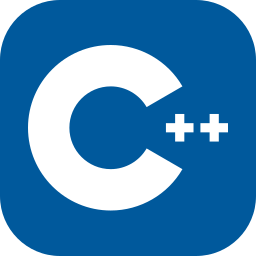
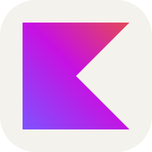
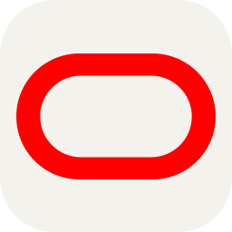
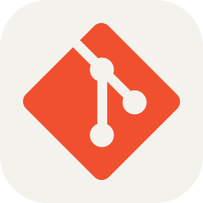
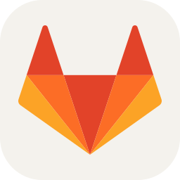
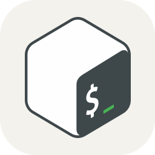
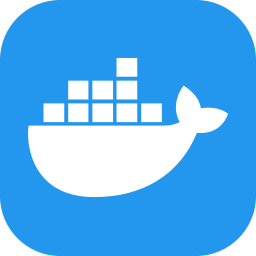
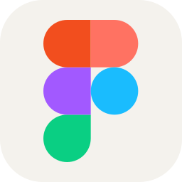
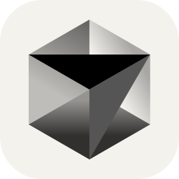

<h1 align="center">Hi, I'm Egor Krivonosov – RedGry 😎</h1>

  
  

- ☕ I'm currently a Java developer.
- 🎓 Master's degree with honors from [ITMO University][itmo].
- 👽 I enjoy learning new technologies and finding the right tools for the job.
- 🔥 I keep improving my skills every year.
- 🏎️ Outside of development, I enjoy karting and collecting.

[<picture><source media="(prefers-color-scheme: dark)" srcset="assets/contacts/email-dark.svg"><source media="(prefers-color-scheme: light)" srcset="assets/contacts/email-light.svg"></picture>][email] Email &nbsp; · &nbsp; [<picture><source media="(prefers-color-scheme: dark)" srcset="assets/contacts/telegram-dark.svg"><source media="(prefers-color-scheme: light)" srcset="assets/contacts/telegram-light.svg"></picture>][tg] Telegram &nbsp; · &nbsp; [<picture><source media="(prefers-color-scheme: dark)" srcset="assets/contacts/vk-dark.svg"><source media="(prefers-color-scheme: light)" srcset="assets/contacts/vk-light.svg"></picture>][vk] VK &nbsp; · &nbsp; [<picture><source media="(prefers-color-scheme: dark)" srcset="assets/contacts/instagram-dark.svg"><source media="(prefers-color-scheme: light)" srcset="assets/contacts/instagram-light.svg"></picture>][instagram] Instagram

## Languages & tools

<table>
  <thead>
    <tr><th align="left" scope="col">Area</th><th colspan="7" align="center" scope="colgroup">Technologies</th></tr>
  </thead>
  <tbody>
    <tr>
      <th align="left" scope="row">Languages &amp; backend</th>
<td align="center">

[<picture><source media="(prefers-color-scheme: dark)" srcset="assets/icons/dark/java.svg"><source media="(prefers-color-scheme: light)" srcset="assets/icons/light/java.svg"></picture>][java] Java

</td>
<td align="center">

[<picture><source media="(prefers-color-scheme: dark)" srcset="assets/icons/dark/python.svg"><source media="(prefers-color-scheme: light)" srcset="assets/icons/light/python.svg"></picture>][python] Python

</td>
<td align="center">

[][cplusplus] C++

</td>
<td align="center">

[<picture><source media="(prefers-color-scheme: dark)" srcset="assets/icons/dark/kotlin.svg"><source media="(prefers-color-scheme: light)" srcset="assets/icons/light/kotlin.svg"></picture>][kotlin] Kotlin

</td>
<td align="center">

[<picture><source media="(prefers-color-scheme: dark)" srcset="assets/icons/dark/spring.svg"><source media="(prefers-color-scheme: light)" srcset="assets/icons/light/spring.svg"></picture>][spring] Spring

</td>
<td align="center">

[][fastapi] FastAPI

</td>
      <td></td>
    </tr>
    <tr>
      <th align="left" scope="row">Frontend</th>
<td align="center">

[][html] HTML5

</td>
<td align="center">

[][css] CSS3

</td>
<td align="center">

[][sass] Sass

</td>
<td align="center">

[][javascript] JavaScript

</td>
<td align="center">

[][jquery] jQuery

</td>
<td align="center">

[<picture><source media="(prefers-color-scheme: dark)" srcset="assets/icons/dark/react.svg"><source media="(prefers-color-scheme: light)" srcset="assets/icons/light/react.svg"></picture>][react] React

</td>
<td align="center">

[<picture><source media="(prefers-color-scheme: dark)" srcset="assets/icons/dark/vuejs.svg"><source media="(prefers-color-scheme: light)" srcset="assets/icons/light/vuejs.svg"></picture>][vuejs] Vue.js

</td>
    </tr>
    <tr>
      <th align="left" scope="row">Databases</th>
<td align="center">

[<picture><source media="(prefers-color-scheme: dark)" srcset="assets/icons/dark/mysql.svg"><source media="(prefers-color-scheme: light)" srcset="assets/icons/light/mysql.svg"></picture>][mysql] MySQL

</td>
<td align="center">

[<picture><source media="(prefers-color-scheme: dark)" srcset="assets/icons/dark/postgresql.svg"><source media="(prefers-color-scheme: light)" srcset="assets/icons/light/postgresql.svg"></picture>][postgresql] PostgreSQL

</td>
<td align="center">

[<picture><source media="(prefers-color-scheme: dark)" srcset="assets/icons/dark/influxdb.svg"><source media="(prefers-color-scheme: light)" srcset="assets/icons/light/influxdb.svg"></picture>][influxdb] InfluxDB&nbsp;3

</td>
<td align="center">

[][mongodb] MongoDB

</td>
<td align="center">

[<picture><source media="(prefers-color-scheme: dark)" srcset="assets/icons/dark/oracle.svg"><source media="(prefers-color-scheme: light)" srcset="assets/icons/light/oracle.svg"></picture>][oracle] Oracle

</td>
      <td></td>
      <td></td>
    </tr>
    <tr>
      <th align="left" scope="row">DevOps &amp; Git</th>
<td align="center">

[<picture><source media="(prefers-color-scheme: dark)" srcset="assets/icons/dark/git.svg"><source media="(prefers-color-scheme: light)" srcset="assets/icons/light/git.svg"></picture>][git] Git

</td>
<td align="center">

[<picture><source media="(prefers-color-scheme: dark)" srcset="assets/icons/dark/github.svg"><source media="(prefers-color-scheme: light)" srcset="assets/icons/light/github.svg"></picture>][github] GitHub

</td>
<td align="center">

[<picture><source media="(prefers-color-scheme: dark)" srcset="assets/icons/dark/gitlab.svg"><source media="(prefers-color-scheme: light)" srcset="assets/icons/light/gitlab.svg"></picture>][gitlab] GitLab

</td>
<td align="center">

[<picture><source media="(prefers-color-scheme: dark)" srcset="assets/icons/dark/bitbucket.svg"><source media="(prefers-color-scheme: light)" srcset="assets/icons/light/bitbucket.svg"></picture>][bitbucket] Bitbucket

</td>
<td align="center">

[<picture><source media="(prefers-color-scheme: dark)" srcset="assets/icons/dark/bash.svg"><source media="(prefers-color-scheme: light)" srcset="assets/icons/light/bash.svg"></picture>][bash] Bash

</td>
<td align="center">

[][docker] Docker

</td>
<td align="center">

[][kubernetes] Kubernetes

</td>
    </tr>
    <tr>
      <th align="left" scope="row">Tools &amp; AI</th>
<td align="center">

[<picture><source media="(prefers-color-scheme: dark)" srcset="assets/icons/dark/jetbrains.svg"><source media="(prefers-color-scheme: light)" srcset="assets/icons/light/jetbrains.svg"></picture>][jetbrains] JetBrains

</td>
<td align="center">

[<picture><source media="(prefers-color-scheme: dark)" srcset="assets/icons/dark/figma.svg"><source media="(prefers-color-scheme: light)" srcset="assets/icons/light/figma.svg"></picture>][figma] Figma

</td>
<td align="center">

[][selenium] Selenium

</td>
<td align="center">

[<picture><source media="(prefers-color-scheme: dark)" srcset="assets/icons/dark/sonarqube.svg"><source media="(prefers-color-scheme: light)" srcset="assets/icons/light/sonarqube.svg"></picture>][sonarqube] SonarQube

</td>
<td align="center">

[<picture><source media="(prefers-color-scheme: dark)" srcset="assets/icons/dark/codex.svg"><source media="(prefers-color-scheme: light)" srcset="assets/icons/light/codex.svg"></picture>][codex] Codex

</td>
<td align="center">

[<picture><source media="(prefers-color-scheme: dark)" srcset="assets/icons/dark/cursor.svg"><source media="(prefers-color-scheme: light)" srcset="assets/icons/light/cursor.svg"></picture>][cursor] Cursor

</td>
      <td></td>
    </tr>
  </tbody>
</table>

⚡ GitHub Stats

  <a href="https://github.com/RedGry?tab=repositories">Repositories</a> · <a href="https://github.com/RedGry?tab=overview">Recent activity</a>

  <a href="https://github.com/RedGry">
    <picture>
      <source media="(prefers-color-scheme: dark)" srcset="https://github-stats-extended.vercel.app/api?username=RedGry&amp;rank_icon=github&amp;show_icons=true&amp;include_all_commits=true&amp;disable_animations=true&amp;theme=radical">
      <source media="(prefers-color-scheme: light)" srcset="https://github-stats-extended.vercel.app/api?username=RedGry&amp;rank_icon=github&amp;show_icons=true&amp;include_all_commits=true&amp;disable_animations=true&amp;theme=default">
      
    </picture>
  </a>

<!-- Links to my pages -->
[email]: mailto:egor_redgry@vk.com
[tg]: https://t.me/redgry
[vk]: https://vk.com/egor_redgry
[instagram]: https://www.instagram.com/egor_redgry/
[itmo]: https://itmo.ru/

<!-- Links to tools and languages -->
[java]: https://dev.java/
[python]: https://www.python.org/
[cplusplus]: https://cplusplus.com/
[kotlin]: https://kotlinlang.org/
[spring]: https://spring.io/
[fastapi]: https://fastapi.tiangolo.com/
[html]: https://developer.mozilla.org/en-US/docs/Web/HTML
[css]: https://developer.mozilla.org/en-US/docs/Web/CSS
[sass]: https://sass-lang.com/
[javascript]: https://developer.mozilla.org/en-US/docs/Web/JavaScript
[jquery]: https://jquery.com/
[react]: https://react.dev/
[vuejs]: https://vuejs.org/
[mysql]: https://www.mysql.com/
[postgresql]: https://www.postgresql.org/
[influxdb]: https://docs.influxdata.com/influxdb3/
[mongodb]: https://www.mongodb.com/
[oracle]: https://www.oracle.com/database/
[git]: https://git-scm.com/
[github]: https://github.com/
[gitlab]: https://about.gitlab.com/
[bitbucket]: https://bitbucket.org/product/
[bash]: https://savannah.gnu.org/projects/bash/
[docker]: https://www.docker.com/
[kubernetes]: https://kubernetes.io/
[jetbrains]: https://www.jetbrains.com/
[figma]: https://www.figma.com/
[selenium]: https://www.selenium.dev/
[sonarqube]: https://www.sonarsource.com/products/sonarqube/
[codex]: https://github.com/openai/codex
[cursor]: https://cursor.com/
